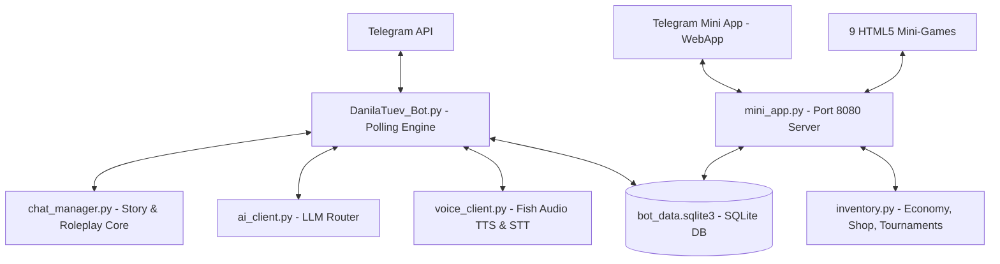

# 🎭 Design Document — Telegram RPG & Gachi MiniApp Bot
**Версия:** 2.5 · **Дата обновления:** 14 ноября 2026 · **Статус:** Активная разработка (Production Ready)

---

## 1. Обзор продукта

Телеграм-бот (**DanilaTuev_Bot**) выступает в роли **полнокровного живого персонажа** в групповых и личных чатах. Он держит ролевую маску (архетип), двигает локальный бытовой сюжет, обладает памятью, реагирует на окружение, поддерживает голосовые реплики через **Fish Audio TTS**, сохраняет инвентарь и предлагает интерактивное веб-приложение **Telegram Mini App («Dungeon Gym»)** с экономикой, магазином приколов и соревновательными аркадами.

---

## 2. Архитектура проекта

---

## 3. Что полностью реализовано (Production Features)

### 3.1 Диалоговая система и отыгрыш персонажа
- **560+ уникальных архетипов** (`archetypes.py`, `cat1`–`cat7`): разделены по колоритным бытовым и абсурдным категориям.
- **Строгий запрет 4-й стены**: персонаж не знает, что он бот/нейросеть, не ссылается на меню, правила или команды; при провокациях реагирует в характере персонажа.
- **Динамические бытовые цели (`_generate_archetype_goal`)**: у персонажа всегда есть актуальная микро-цель с препятствием (починить карбюратор, спрятаться от коменды, догнать должника).
- **Сюжетные фазы (`_PHASES`)**: эскалация сюжета (Завязка → Препятствие → Кульминация → Развязка) без сброса на каждом шаге.
- **Инициативный ход (Proactive Push)**: при тишине в чате бот не пишет дежурные фразы, а рассуждает наедине с собой в рамках своей цели.
- **Лимиты реплик**: увеличенный бюджет токенов (1100 токенов), насыщенные сочные ответы (3–5 предложений) с умной обрезкой `smart_trim`.

### 3.2 Голосовая система (Fish Audio TTS & Multimodal STT)
- **Прямой синтез речи через официальный Fish Audio API** (`https://api.fish.audio/v1/tts`).
- Использование модели `model: s2.1-pro-free` со сверхбыстрым ответом и нулевой задержкой.
- Zero-shot клонирование голоса через `application/msgpack` по образцам голоса пользователей из чата (`/voice_clone`, пресеты `voices/`).
- Голосовой ввод через NordRouter multimodal STT (транскрипция входящих войсов).

### 3.3 Игровая арена (9 HTML5 мини-игр без казино и NFT)
Все игры взяты из проверенных открытых GitHub-репозиториев и адаптированы под Telegram WebApp:
1. 🏗 **Стек Штанги • Dungeon Bench** (по мотивам `iamkun/tower_game`): 40 оригинальных спрайтов, звуки, идеальный тайминг укладки блинов на кран.
2. 🪓 **Leather Lumberjack • Лесоруб Билли** (на базе `falsam/Timberman-JS`): спрайты дровосека, пней, веток, звуки рубки, кнопка «🔄 Играть заново» по центру при Game Over.
3. 🎯 **Спанкинг-тир • Spank Hit** (на базе `ManoRanjithK/KnifeHitReplica`): точный угловой трекинг рукояток, физика отскакивающего кувыркающегося ножа с искрами и гравитацией.
4. 🏀 **Dungeon Slam • Бросок в кольцо** (`swipe_basketball`): физика точного свайпа, сетка, звуки swish и режим On Fire.
5. 🧱 **Smash the Jabroni • Кибер-Дробилка** (`brick_breaker`): сочный арканоид с мульти-шарами, лазерами и разрушаемыми неоновыми блоками.
6. 🌈 **Rainbow Dungeon • Цветной флекс** (`colorswitch`): 5 типов вращающихся неоновых препятствий и Web Audio API.
7. 🏒 **Ice Gym Clash • Аэрохоккей Слейвов** (`airhockey`): аэрохоккей с физикой шайбы и адаптивным AI-соперником.
8. 🔨 **Whack the Jabroni • Накажи Слейва** (`whack`): скоростная аркада на реакцию с золотыми целями и бомбами на 45 сек.
9. 🔢 **2048 Gym Power • Сила трех сотен баксов** (`game2048` на базе `gabrielecirulli/2048`): свайп-механика объединения плиток до 2048+.

### 3.4 Мобильный адаптив и UX вьюпорта игр
- **Полноэкранный режим 100vw × 100dvh**: убран сплющивающий `object-fit: contain`. Canvas динамически масштабируется под пропорции современных смартфонов (19.5:9, 20:9).
- **Крупные элементы**: спрайты, мишени, корзины и кнопки видны четко и оптимизированы под пальцы.
- **Безопасная зона**: интеграция `env(safe-area-inset-top)` и `env(safe-area-inset-bottom)` для iPhone и Android с вырезами камер.

### 3.5 Лидерборды и соревновательный движок
- База данных SQLite (`bot_data.sqlite3`, таблица `game_leaderboard`).
- Автоматическая отправка очков при Game Over через `POST /api/game/submit_score`.
- Эндпоинты: `/api/game/leaderboard` и `/api/game/all_leaderboards`.
- **Инлайн-лидерборд**: по кнопке «🏆 Топ» таблица лидеров плавно раскрывается прямо внутри карточки игры.
- **Лидерборд при Game Over**: после поражения на экране сразу отображается топ игроков и личный ранг с кнопками рестарта.

### 3.6 Внутренняя экономика (Coins) и Daily Streak
- **Бесплатный заработок монет**:
  - Начисление монет за сообщения в чате (с антиспам-кулдауном 60 сек).
  - Начисление монет за счет в мини-играх.
  - Ежедневный стрик входа (`daily_streak`) с прогрессивной наградой.
- Виджет баланса монет 🪙 и огненный индикатор стрика 🔥 в шапке Mini App с анимацией `coin-pulse`.

### 3.7 Магазин приколов (Leather Shop / $300 Store)
- **👑 LORD OF THE DUNGEON (VIP-статус)** — **5000 🪙**: элитный постоянный статус. Персонаж признает игрока своим Боссом, обращается на «Вы, мой Босс» с поклоном в каждом сообщении, дает золотую корону в Зале славы.
- 🐟 **Дружеский лещ / Мокрое полотенце (120 🪙)**: бот отвешивает звонкую пощечину другу при входе в чат.
- 🎯 **Спанкинг / Заказной подкол (100 🪙)**: едкая авторская шутка на заданную тему.
- 🕵️ **Анонимный слух / Сплетня (180 🪙)**: вброс инсайда в чат с сохранением анонимности покупателя.
- 🛸 **Режим Паранойи и Масонов на 1 час (250 🪙)**: бот подозревает всех в чате в работе на рептилоидов.
- 📢 **Мегафон / Крик на всю качалку (300 🪙)**: срочное объявление через рупор на весь чат.
- 🛡️ **Неприкасаемый Слейв (600 🪙)**: недельный иммунитет от нападок и подколов бота.
- ⚡ **Атмосфера Подземелья (150 🪙)**: смена настроения бота на 30 минут (Gachi, Cyberpunk, Бабушка, Критик).
- 🏷️ **Кожаный Титул (200 🪙)**: кастомный титул игрока, используемый ботом при обращении.

### 3.8 Еженедельный кубок чата (Weekly Tournament Cup)
- Автоматические недельные сезоны (понедельник – воскресенье 23:59:59).
- Очки суммируются из всех 9 мини-игр.
- Таймер обратного отсчета в реальном времени.
- Призовой банк: 🥇 +500 монет и титул «Boss of this Gym», 🥈 +250 монет, 🥉 +100 монет.
- Команды в Telegram: `/cup`, `/tournament`, `/coins`, `/shop`, `/buy`.

### 3.9 Визуальный стиль — Deep Blue / Gachi Neon Theme
- Глубокие синие оттенки спортзала (`#050811`, `#0a0f1d`, кобальт, металлическая сетка).
- Неоновые акценты электрического циана (`#00d2ff`, `#38bdf8`, `#3b82f6`).
- Гачи-эстетика: бейджи *«DEEP DARK GYM • LEATHER CLUB»*, *«BOSS OF THIS GYM»*, *«DUNGEON MASTER»*.
- Главная вкладка по умолчанию — **«🎮 Dungeon Games»** (открывается мгновенно).

---

## 4. Что находится в планах (Roadmap / Backlog)

### 4.1 ⚔️ Дуэли между игроками в реальном времени («Стенка на стенку»)
- [ ] Команда в чате: `/duel @username <игра> <ставка_монет>` (например, `/duel @alex timberjack 100`).
- [ ] Бот генерирует инлайн-карточку дуэли с таймером 10 минут.
- [ ] Обоим игрокам дается 1 попытка в Mini App; победитель забирает банк, а бот публикует итог дуэли с ироничным комментарием от лица текущего персонажа.

### 4.2 🎒 Предметные квесты с инвентарем («Бытовые проблемы бота»)
- [ ] Бот в диалоге периодически жалуется на нехватку бытового ресурса (закончился бензин, перегорела лампа, хочется кофе).
- [ ] Игроки используют инвентарь: `/use канистра бензина | заливаю в бак персонажа`.
- [ ] Бот выдает уникальную сюжетную ветку, секретное достижение и щедрую пачку монет.

### 4.3 🎙️ Персональные голосовые пресеты под каждый архетип
- [ ] Привязка `reference_id` / голоса Fish Audio к конкретным категориям архетипов (хриплый бас для таксиста, бодрый голос для студента, строгий тон для профессора).
- [ ] Автоматическое переключение тембра речи при ежедневной смене архетипа в полночь.

### 4.4 🏅 Система ачивок и коллекционных карточек в Mini App
- [ ] Вкладка «Коллекция»: 30+ уникальных достижений (*«Первая кровь в тире»*, *«Срубил вековой дуб»*, *«Набрал 2048 без единой ошибки»*, *«Миллионер из качалки»*).
- [ ] Награды в виде коллекционных бейджей профиля и бонусных множителей очков.

### 4.5 🤖 Интерактивная «Мафия с ботом» в чате
- [ ] Мини-событие раз в неделю: бот объявляет детективное происшествие в чате (украли гирю из качалки).
- [ ] Бот в ЛС раздает улики трем подозреваемым, а в общем чате ведет допрос и вычисляет виновного на основе реплик участников.

---

## 5. Сводная таблица статуса компонентов

| Модуль | Компонент | Статус | Примечание |
|---|---|:---:|---|
| **Core Bot** | Ролевой диалог и сюжетные фазы | ✅ Готово | 560+ архетипов, запрет 4-й стены, авто-цели |
| **TTS/STT** | Fish Audio TTS & Gemini STT | ✅ Готово | Прямой API, модель `s2.1-pro-free`, OGG Opus |
| **Games** | 9 мини-игр в Mini App | ✅ Готово | Полная адаптация под мобилки 100vw/dvh |
| **Games** | Инлайн-лидерборды и Game Over | ✅ Готово | Раскрытие в карточке + экран при поражении |
| **Economy** | Монеты и Daily Streak | ✅ Готово | Заработок в чате и играх, стрик-серии |
| **Shop** | Магазин приколов | ✅ Готово | VIP за 5000 🪙, лещ, паранойя, мегафон |
| **Cup** | Еженедельный кубок недели | ✅ Готово | Авто-сезоны, таймер, титулы и призы |
| **UI/UX** | Deep Blue Gachi Theme | ✅ Готово | Каталог игр открывается первым, синий хром |
| **Duels** | Дуэли 1 на 1 в чате | ⏳ В планах | Разработка PvP-механики со ставками |
| **Quests** | Бытовые квесты персонажа | ⏳ В планах | Интеграция с `/use` предметами инвентаря |
| **Voices** | Авто-смена тембра под архетип | ⏳ В планах | Маппинг тембров Fish Audio на категории |
